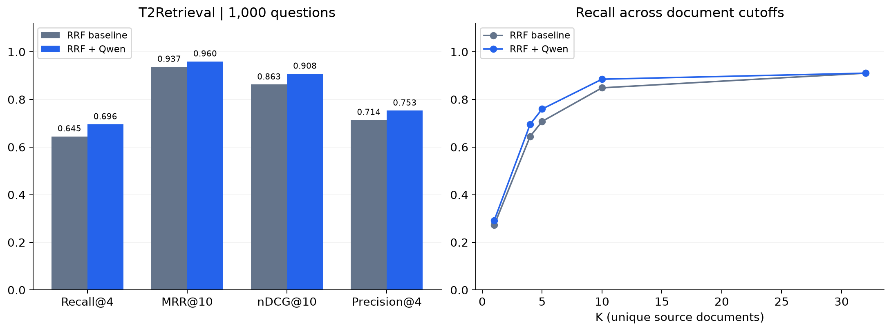
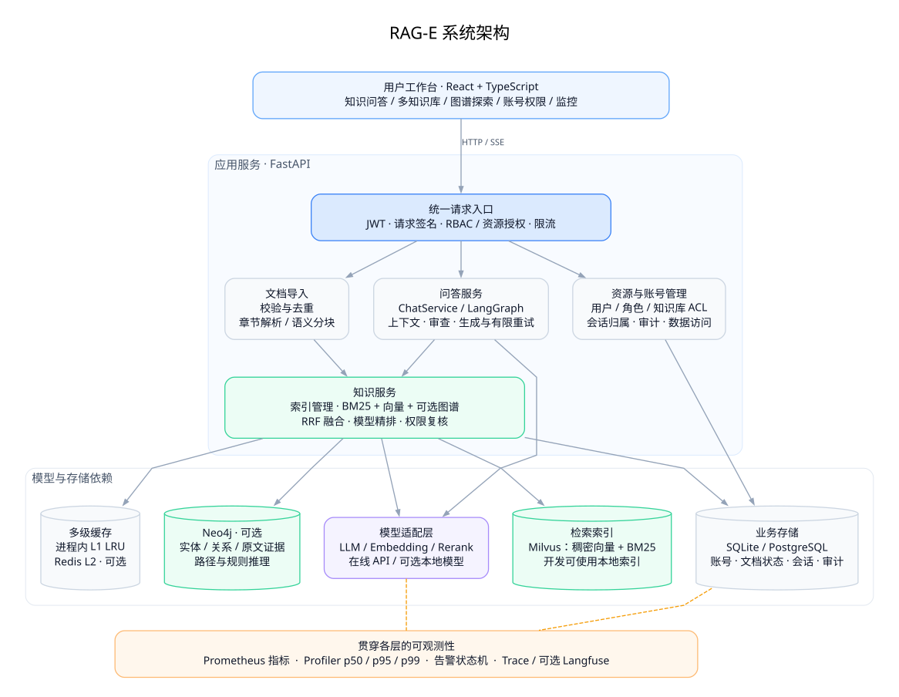
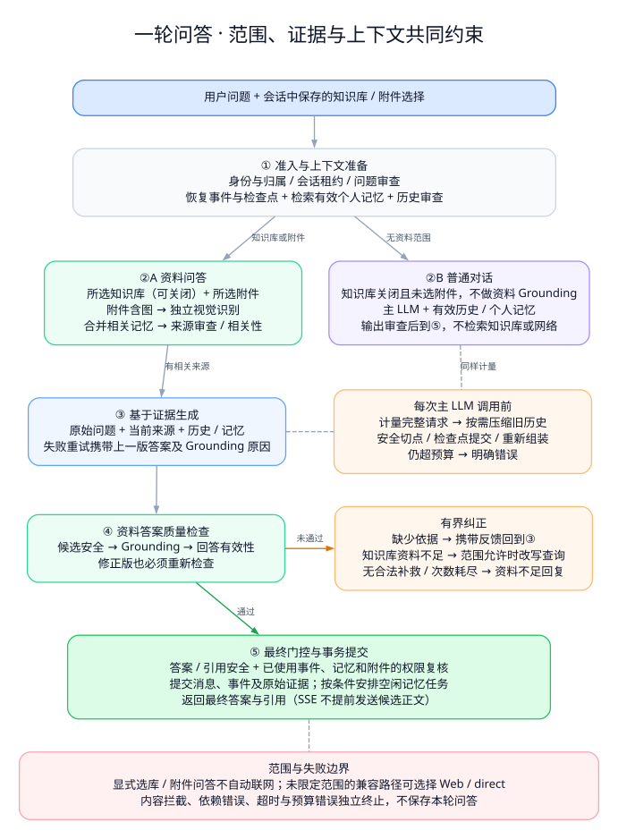

# 🧠 RAG-E · 通用知识与图谱工作台

> **A Knowledge Workspace for Grounded Answers** — 面向自有资料的多知识库问答、知识图谱与可观测 RAG 应用。

<p align="center">
  <strong>连接资料、问题与证据的知识工作台</strong><br>
  多知识库 · LangGraph 编排 · 混合检索与精排 · Neo4j 图谱 · 细粒度权限 · 全链路观测
</p>

<p align="center">
  
  
  
  
  
  
  
  <a href="LICENSE"></a>
</p>

RAG-E 将文档导入、检索增强生成、图谱探索和账号权限整合到同一工作台。按项目或主题建立知识库，选择一个或多个提问，并通过引用回到原始资料。

系统适用于技术文档、产品资料、企业制度、项目档案和科研笔记等场景，不限定行业。默认演示模式无需模型密钥，可先体验完整操作流程，再接入在线 LLM、Embedding、精排与 Milvus。

**快速入口：** [启动项目](#快速开始) · [接入真实模型](#models) · [查看检索评测](#公开数据集评测) · [阅读完整文档](docs/README.md)

---

## 📑 目录

- [✨ 项目亮点](#highlights)
- [📊 公开数据集评测](#公开数据集评测)
- [🏗️ 系统架构](#architecture)
- [🎯 核心特性](#features)
- [🛠️ 技术栈](#stack)
- [🚀 快速开始](#快速开始)
- [🔌 模型与参数配置](#models)
- [📁 项目结构](#structure)
- [📦 部署与运行边界](#deployment)
- [🧪 测试体系](#testing)
- [🔄 CI 流水线](#ci)
- [📚 文档索引](#docs)
- [🤝 参与贡献](#contributing)
- [📈 Roadmap](#roadmap)
- [📄 许可证](#license)

---

<a id="highlights"></a>

## ✨ 项目亮点

| 维度 | 已实现能力 |
|---|---|
| 📚 **多知识库工作台** | 单库 / 多库选择、会话范围记忆、文档状态与来源展开；问答范围贯穿检索、图谱、缓存和引用校验 |
| 🔍 **混合检索与模型精排** | BM25 + 稠密向量 + 可选图谱召回，RRF 融合后通过在线 API / 本地 CrossEncoder 精排 |
| 🤖 **有界 Agent 工作流** | LangGraph 自适应 RAG 与工具路由，串联资料相关性、问题改写、答案生成及事实依据检查 |
| 🕸️ **知识图谱与证据** | Neo4j 实体关系抽取、原文证据、多跳路径、子类传递推理、Cypher 缓存与力导向图交互 |
| ⚡ **性能工程** | L1 LRU + L2 Redis、共享连接池、有界批量推理、每进程共享检索服务与阻塞操作卸载 |
| 👁️ **全链路可观测性** | Prometheus、`normal → pending → firing` 告警状态机、p50/p95/p99 Profiler、可选 Langfuse 追踪 |
| 🔐 **多用户与安全** | JWT、可管理 RBAC、知识库 ACL、资源归属、请求签名防重放、脱敏审计和 AES-256-GCM 加密 |
| 📦 **工程交付** | React + TypeScript 工作台、锁定依赖、数据库迁移、自动化测试、Compose 与 Kubernetes 模板 |

---

<!-- FULL_EVALUATION:START -->

## 公开数据集评测

以下为已完成的 **T2Retrieval 检索实验**：1,000 个问题、10,000 篇文档子集。两组使用相同初始候选池，RRF 为去精排对照，Qwen 组增加在线模型精排。

| 检索指标 | RRF | RRF + Qwen |
|---|---:|---:|
| Recall@4 | 0.6451 | **0.6958** |
| Recall@10 | 0.8489 | **0.8852** |
| MRR@10 | 0.9373 | **0.9596** |
| nDCG@10 | 0.8629 | **0.9081** |

本轮精排使 Recall@4 提高 **5.08 个百分点**。指标以去重来源文档为单位，使用官方相关性标注和 `ir_measures` 计算。



实验使用 Milvus、语义分块 1500/150、32 条候选，图谱融合关闭。检索报告的 K 表示去重来源文档数；生成配置的 Top-K 4 表示片段数。该实验只测检索，不生成答案；子集结果不代表完整数据集榜单成绩或生产并发性能。

[实验方法](docs/EVALUATION_PLAN.md) · [运行与复现](docs/EVALUATION.md) · [完整实验记录](docs/FULL_EVALUATION.md)

<!-- FULL_EVALUATION:END -->

---

<a id="architecture"></a>

## 🏗️ 系统架构



[查看高清 PNG](docs/assets/diagrams/architecture.png) · [可编辑源图](docs/assets/diagrams/architecture.dot)

图中实线表示主要调用和存储依赖，虚线表示观测采集；部分重复连接省略。模型、索引和缓存由服务层复用，可选组件按配置启用。

`Container` 在应用生命周期中创建并复用检索、模型和缓存资源。文档状态以 SQL 为准，返回结果前复核权限与就绪状态；图谱构建和向量入库分别记录状态。详见[架构与一致性设计](docs/ARCHITECTURE.md)。

---

<a id="features"></a>

## 🎯 核心特性

### 📚 多知识库与可追溯问答

1. **组织资料**：按项目创建知识库，上传文档并查看处理状态；可按用户或角色共享读取、编辑、管理权限。
2. **限定范围**：聊天时勾选一个或多个知识库，范围随会话保存；切换范围后，后续模型上下文从切换处重新开始。
3. **核对证据**：展开回答引用查看原始片段，或在检索试验台独立检查召回结果。
4. **持续追问**：保存个人会话与历史记录，通过上下文处理理解后续问题。

选库问答只检索所选且获授权的资料，不会静默扩大到其他库或网络。[操作与隔离规则](docs/KNOWLEDGE_SCOPE.md)

### 🔍 文档处理与 RAG 流水线

支持 UTF-8 **`.md`、`.markdown`、`.txt`**，默认单文件上限 5 MB。分块按 **Markdown 章节 → 语义分组 → 长度兜底** 执行，保存标题层级、文件名和片段序号。

| 环节 | 当前共享参数与行为 |
|---|---|
| 结构与语义分块 | 开启语义分组，单块最多 1500 字符，组内长度切分重叠 150 字符 |
| 文档限制 | 默认每份文档最多 2000 个分块 |
| 多路召回 | Milvus HNSW / COSINE + BM25，图谱开启时加入原文片段 |
| 融合与精排 | RRF 融合，32 条候选，经模型精排后选择 Top-K 4 个片段 |
| 质量检查 | 来源安全与相关性 → 答案生成 → 输出安全、事实依据与回答有效性 |
| 纠正与终止 | 有上限的问题改写和重新生成；证据不足时明确提示 |

1500/150 的单位是字符而非 Token；章节与语义组之间不保证重叠。代码围栏内的 `#` 不会被当作标题，但长代码块和表格尚无完整保留保证。

<details>
<summary><strong>选定知识库的问答流程</strong></summary>



[查看高清 PNG](docs/assets/diagrams/qa-flow.png) · [可编辑源图](docs/assets/diagrams/qa-flow.dot)

绿色为通过路径，橙色为纠正分支；“回到② / ④”分别表示重新检索或重新生成。安全拦截、依赖错误和超时独立终止，不进入质量重试。此图展示已选知识库的问答路径。

`adaptive` 和 `agentic` 两种模式共享权限和质量门控。SSE 展示节点进度及审查后的完整答案，不逐 Token 输出未经审查的候选内容。精排失败默认报错，也可显式配置带标记的 RRF 回退。

</details>

[文档处理实现](backend/app/knowledge/rag/document_processor.py) · [模型精排](docs/RERANK.md) · [共享参数](docs/SHARED_PIPELINE.md)

### 🕸️ 知识图谱

- **实体与关系**：真实模型从自然语言抽取，校验名称与证据在原文中的对应；演示模式解析明确三元组。
- **交互探索**：实体搜索、节点选择与拖拽、空白画布平移、滚轮缩放、视图复位和关系证据查看。
- **路径与推理**：展示最多三跳的关联路径；同方向子类关系链支持传递推理。
- **索引维护**：图谱状态独立可见，失败可重建；文档删除和重建使相关 Cypher 缓存失效。

图谱是可选服务，共享生产与评测模板默认关闭融合。[Neo4j 接入与使用](docs/GRAPH_PERFORMANCE_OBSERVABILITY.md)

### 🔐 账号权限与数据安全

| 能力 | 实现 |
|---|---|
| 账号与角色 | 创建账号、启停、重置密码、撤销会话；支持编辑 `user` 权限和分配自定义角色 |
| 资源授权 | 角色控制操作能力，知识库 ACL 控制资料范围；会话始终校验归属 |
| 请求保护 | JWT 绑定客户端公钥，请求签名覆盖方法、路径、正文摘要、时间与一次性编号 |
| 数据与审计 | AES-256-GCM 保护业务正文，敏感字段脱敏，HMAC 审计链校验和密钥轮换 |
| 内容审查 | 输入、上下文、来源和输出独立审查；八类阈值可配置，审查故障时停止放行 |

[账号与安全指南](docs/SECURITY.md) · [内容审查机制](docs/MODERATION.md)

### ⚡ 性能与可观测性

| 模块 | 实现 |
|---|---|
| 多级缓存 | L1 LRU / TTL、Redis L2 回填、同键并发加载合并；读取后仍复核资料权限 |
| 连接与批处理 | HTTP / Bolt 连接池、共享模型客户端、有界批量并发 |
| 资源复用 | 每个 worker 复用检索与缓存实例，主要阻塞 I/O / CPU 操作在线程池执行 |
| 指标与剖析 | Prometheus 请求、耗时、缓存、模型用量及依赖指标；Profiler 展示 p50/p95/p99 |
| 告警与追踪 | `normal → pending → firing` 状态机；可选 Langfuse 模型调用追踪 |

Langfuse 默认不导出问题、文档和答案正文。连接池和并发参数可调，实际容量以目标部署环境测量为准。[性能与观测指南](docs/GRAPH_PERFORMANCE_OBSERVABILITY.md)

---

<a id="stack"></a>

## 🛠️ 技术栈

<details>
<summary><strong>📦 后端与检索</strong></summary>

| 类别 | 技术 |
|---|---|
| API 与配置 | Python 3.11–3.13、FastAPI、Uvicorn、Pydantic Settings |
| 工作流与模型 | LangGraph、HTTPX、Chat Completions 兼容服务 |
| 检索与精排 | Milvus、BM25、RRF、在线 Rerank API、可选 Sentence Transformers CrossEncoder |
| 图谱 | Neo4j、异步 Bolt driver、参数化 Cypher |
| 业务数据 | SQLAlchemy、Alembic、SQLite / PostgreSQL |
| 缓存与安全 | Redis、PyJWT、P-256 请求签名、scrypt、cryptography AES-GCM |
| 指标与评测 | Prometheus Client、Langfuse、ir_measures、rouge-score、Matplotlib |

</details>

<details>
<summary><strong>🎨 前端工作台</strong></summary>

| 类别 | 技术 |
|---|---|
| 应用框架 | React 19、TypeScript、Vite |
| 状态管理 | Zustand |
| 图谱与内容 | d3-force、React Markdown、remark-gfm |
| 界面与测试 | Lucide、Vitest、Testing Library、Prettier |

</details>

<details>
<summary><strong>☁️ 部署与工程工具</strong></summary>

| 类别 | 技术 |
|---|---|
| 依赖管理 | uv + uv.lock、npm + package-lock.json |
| 部署 | Docker Compose、Nginx、Kubernetes 模板 |
| 索引依赖 | Milvus、etcd、MinIO |
| 质量与自动化 | Ruff、pytest、GitHub Actions |

</details>

具体版本以[后端依赖](backend/pyproject.toml)、[前端依赖](frontend/package.json)及锁文件为准。

---

<a id="快速开始"></a>

## 🚀 快速开始

默认 `demo` 模式无需模型 API Key、GPU、Milvus 或 Neo4j，适合体验文档导入、检索、会话和权限流程。演示回答采用规则与资料摘录；真实生成和语义判断使用 `live` 模式。

### 环境要求

| 运行方式 | 依赖 | 工作台入口 |
|---|---|---|
| 本地开发 | Python 3.11–3.13、uv、Node.js 22.12+、npm | `http://localhost:5173` |
| Docker Compose | Docker、Compose v2 | `http://localhost:8080` |

先下载仓库并进入根目录。首次安装依赖需要网络；以下三种启动方式任选其一。

<details open>
<summary><strong>Windows 本地开发</strong></summary>

首次初始化：

```powershell
powershell -ExecutionPolicy Bypass -File .\scripts\setup.ps1
```

分别打开两个终端，均从仓库根目录运行：

```powershell
# 终端一：后端
powershell -ExecutionPolicy Bypass -File .\scripts\start_backend.ps1
```

```powershell
# 终端二：前端
powershell -ExecutionPolicy Bypass -File .\scripts\start_frontend.ps1
```

</details>

<details>
<summary><strong>macOS / Linux 本地开发</strong></summary>

```bash
# 首次初始化
bash scripts/setup.sh
```

分别在两个终端运行：

```bash
# 终端一
bash scripts/start_backend.sh
```

```bash
# 终端二
bash scripts/start_frontend.sh
```

</details>

<details>
<summary><strong>Docker Compose</strong></summary>

首次运行复制配置；已有 `.env` 时保留原文件：

```bash
cp .env.example .env
docker compose up -d --build
docker compose exec backend python -m app.cli ingest /app/data/documents
```

PowerShell 的复制命令为 `Copy-Item .env.example .env`。默认容器组合包含前端、后端、PostgreSQL 和 Redis，数据库使用独立持久卷。

</details>

本地初始化脚本会安装依赖、创建数据库与管理员，并导入合成演示资料。已有配置及管理员密码不会被覆盖。

**首次登录：** 全新数据库的示例账号为 `admin` / `rag-e-demo-2026`，取自 `.env.example`。已有部署使用实际设置的密码；修改初始化配置不会重置已有账号。

登录后可对示例知识库提问：**“青禾项目有哪些阶段？”** 或 **“发布前需要完成哪些检查？”**，再展开回答引用查看原文。

开发 API 文档：<http://localhost:8000/docs>；就绪检查：`/api/v1/health/ready`。业务 API 需要认证与请求签名，脚本接入可使用 [SecurityClient](backend/app/security_client.py)。

---

<a id="models"></a>

## 🔌 模型与参数配置

LLM、Embedding 与 Rerank 分别配置，可以使用不同供应商。仓库提供以下在线模型组合的模板，无需本地下载权重：

| 环节 | 模板模型 | 凭据字段 |
|---|---|---|
| 回答、相关性与依据检查 | DeepSeek `deepseek-flash` | `RAGE_LLM_API_KEY` |
| 文档与问题向量 | OpenAI `text-embedding-3-small`，1536 维 | `RAGE_EMBEDDING_API_KEY` |
| 在线模型精排 | 硅基流动 `Qwen/Qwen3-Reranker-0.6B` | `RAGE_RERANK_API_KEY` |

### 配置放在哪里

| 文件 | 职责 |
|---|---|
| `.env` | 本地开发运行模式、服务连接与凭据 |
| `config/rag.production.json` | 生产与评测共用的模型、分块、检索、精排及审查参数 |
| `.env.production` | 生产凭据、存储连接、域名与安全设置 |
| `.env.eval` | 独立评测凭据与依赖连接 |

准备生产或评测时，在根目录从公开模板创建实际文件。只复制尚不存在的文件：

```powershell
Copy-Item config/rag.production.example.json config/rag.production.json
Copy-Item .env.production.example .env.production
Copy-Item .env.eval.example .env.eval
```

macOS / Linux 使用 `cp`。随后编辑 JSON 中的模型和端点，并在对应环境文件填写 API Key、数据库和服务地址。两个环境都通过 `RAGE_PIPELINE_PROFILE=config/rag.production.json` 读取共享规则，实际配置不提交 Git。

这一步只准备配置文件；开发服务默认仍读取 `.env`。切换本地开发至真实模型见[模型接入指南](docs/QUICKSTART.md)，生产启动使用[生产 Compose 组合](docs/DEPLOYMENT.md#生产配置)，评测使用[独立运行器](docs/EVALUATION.md)。

模型名称需对应账号可用服务，兼容端点必须使用匹配的凭据。更换 Embedding 模型、端点、维度或分块策略后，需要重新处理资料并建立新索引。

---

<a id="structure"></a>

## 📁 项目结构

```text
RAG-E/
├── backend/
│   ├── app/
│   │   ├── api/               # HTTP 接口与请求校验
│   │   ├── agents/            # LangGraph 工作流
│   │   ├── knowledge/         # 文档处理、向量与图谱
│   │   ├── services/          # 问答、检索、模型与安全服务
│   │   ├── infrastructure/    # 资源生命周期与数据访问
│   │   └── evaluation/        # 数据集、指标与复现工具
│   └── tests/                 # 自动化与外部集成测试
├── frontend/src/              # React + TypeScript 工作台
├── config/                    # RAG 参数与评测计划模板
├── data/documents/examples/   # 可导入的合成演示资料
├── docs/                      # 使用指南、架构、评测与历史归档
├── deploy/                    # 容器依赖与监控配置
├── k8s/                       # Kubernetes 模板
└── scripts/                   # 初始化、启动、验证与发布检查
```

---

<a id="deployment"></a>

## 📦 部署与运行边界

| 环境 | 推荐入口 |
|---|---|
| 本地功能体验 | 默认 demo、SQLite、本地检索；使用本页启动脚本 |
| 真实模型开发 | `.env` 配置在线模型与依赖；见[模型接入](docs/QUICKSTART.md) |
| 生产部署 | 共享 RAG JSON、PostgreSQL、Milvus、Redis、独立密钥及 HTTPS；见[部署指南](docs/DEPLOYMENT.md) |
| Kubernetes | 使用仓库内[清单模板](k8s/README.md)，配置镜像、Secret、存储与 Ingress |

生产模板强制安全配置，并关闭自动数据库迁移；部署时先准备持久化密钥与存储，再独立迁移并启动服务。生产 Compose 覆盖文件要求 **Compose 2.24.4+**。Kubernetes 清单目前是可配置模板，尚未完成集群验收。

### 当前边界

- PDF、Word、Excel、PPT、图片和扫描件需要先转换为 Markdown / TXT；原生解析与 OCR 尚未接入。
- 图谱、Redis L2 和 Langfuse 需要配置对应服务；启动默认演示不意味着这些集成已启用。
- 内容审查与事实依据检查用于约束回答，效果仍需结合业务资料评测。
- 大规模导入的持久化任务队列、企业 SSO 与独立组织目录属于后续扩展方向。

---

<a id="testing"></a>

## 🧪 测试体系

依赖版本由 `backend/uv.lock` 和 `frontend/package-lock.json` 锁定。提交前运行：

```bash
# 后端
cd backend
uv sync --frozen --extra dev --extra milvus --extra evaluation
uv run ruff check app tests
uv run ruff format --check app tests
uv run pytest -q

# 前端
cd ../frontend
npm ci
npm run format:check
npm test
npm run build
```

| 测试范围 | 覆盖内容 |
|---|---|
| 后端 | API、鉴权、授权、文档导入、检索、工作流、安全审查、缓存与评测口径 |
| 前端 | 登录、知识库范围、会话、SSE、图谱指针交互、Markdown 安全渲染 |
| 外部集成 | 显式配置后执行 Neo4j、Redis、Milvus、PostgreSQL 等真实服务测试 |
| 发布文件 | `python scripts/check_publication.py` 检查公开文件范围、链接与常见凭据格式 |

普通模型测试使用模拟协议，不调用付费服务；真实模型质量评测单独运行。详见[测试与验收](docs/TESTING.md)。

---

<a id="ci"></a>

## 🔄 CI 流水线

[GitHub Actions](.github/workflows/ci.yml) 支持手动运行，并在 PR 创建、重新打开或提交更新时自动执行；普通 push 不单独触发。工作流包含三个作业：

| 作业 | 检查内容 |
|---|---|
| **Backend** | 锁定依赖安装、Ruff、pytest 与覆盖率、临时 PostgreSQL 集成测试、发布文件检查、Compose 配置和后端镜像构建 |
| **Frontend** | npm ci、Prettier、Vitest、TypeScript / Vite 构建、前端镜像构建 |
| **Graph Integration** | 启动 Neo4j / Redis 服务，执行图谱与安全外部集成测试 |

手动运行入口：仓库 **Actions → RAG-E CI → Run workflow**。首次使用需先将工作流文件推送到默认分支；向已有 PR 的分支推送新提交，仍会触发 PR 检查。流水线状态以 GitHub 实际执行结果为准。当前提供构建与验证，镜像自动发布、漏洞扫描和集群部署流水线尚未接入。

---

<a id="docs"></a>

## 📚 文档索引

| 想做什么 | 阅读入口 |
|---|---|
| 接入自己的模型和资料 | [模型配置](docs/QUICKSTART.md) · [精排接入](docs/RERANK.md) · [知识库范围](docs/KNOWLEDGE_SCOPE.md) |
| 理解检索和问答链路 | [系统架构](docs/ARCHITECTURE.md) · [生产与评测共享参数](docs/SHARED_PIPELINE.md) |
| 管理账号、权限与内容审查 | [安全体系](docs/SECURITY.md) · [内容审查](docs/MODERATION.md) |
| 启用图谱或排查性能 | [图谱、缓存、指标与追踪](docs/GRAPH_PERFORMANCE_OBSERVABILITY.md) |
| 部署和维护服务 | [Docker 与备份](docs/DEPLOYMENT.md) · [Kubernetes](k8s/README.md) |
| 开发、测试或发布仓库 | [贡献指南](docs/CONTRIBUTING.md) · [测试说明](docs/TESTING.md) · [发布说明](docs/PUBLISHING.md) |

完整目录见[文档导航](docs/README.md)。历史记录与当前使用指南分别维护。

---

<a id="contributing"></a>

## 🤝 参与贡献

欢迎提交问题、改进文档、补充测试或完善功能。开始前请阅读[贡献指南](docs/CONTRIBUTING.md)。

- **反馈问题**：附上复现步骤、运行模式、依赖状态和脱敏错误信息。
- **修改代码**：在独立分支开发，说明问题、最终行为与实际验证结果。
- **调整配置**：同步更新公开模板和文档，保留生产与评测参数的一致性。
- **提交资料**：仅提交有权公开的内容，不包含真实凭据、业务数据或模型缓存。

公开仓库准备与数据边界见[发布说明](docs/PUBLISHING.md)。

---

<a id="roadmap"></a>

## 📈 Roadmap

### ✅ 已实现

- [x] 多知识库管理、单 / 多库问答、来源引用与会话范围隔离
- [x] LangGraph 工作流、混合检索、在线 / 本地模型精排
- [x] Neo4j 图谱抽取、证据、路径与交互可视化
- [x] 多用户、RBAC、知识库授权、防重放、审计与加密
- [x] 内容审查、L1 / L2 缓存、连接池与有界并发
- [x] Prometheus、Profiler、告警状态机与 Langfuse 接入
- [x] Compose、数据库迁移、自动化测试与公开数据集检索评测

### 📋 后续方向

- [ ] PDF / Office 原生解析与 OCR
- [ ] 证据选择、跨片段补全与回答检查优化
- [ ] 大规模文档导入的持久化任务队列
- [ ] 企业 SSO 与独立组织目录
- [ ] 业务留出集评测与独立质量核验
- [ ] 镜像自动发布与集群部署验收

---

<a id="license"></a>

## 📄 许可证

RAG-E 采用 [MIT License](LICENSE)。

公开数据集、模型和导入资料适用各自条款。仓库提供合成演示资料与评测汇总，不打包模型权重、新闻数据集或历史 PDF；数据边界见 [data/README.md](data/README.md)。
