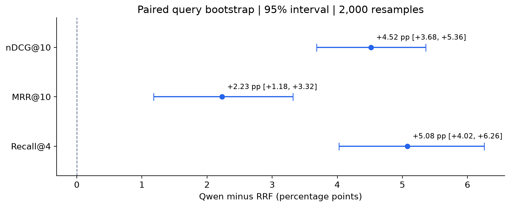
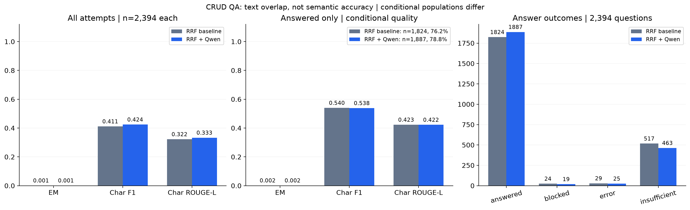
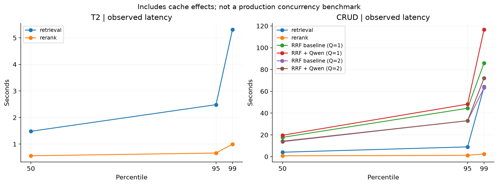

# 公开数据集评测结果

实验完成时间：**2026-10-11 04:10（北京时间）**。T2 子集 1,000 题、CRUD 三个 QA 任务 2,394 题全部执行；“完成”包含拒答、错误与安全拦截，不表示每道题都成功回答。

[复现命令](EVALUATION.md) · [指标口径](EVALUATION_PLAN.md) · [质量诊断](QUALITY_DIAGNOSIS.md) · [聚合指标](assets/evaluation/metrics.json)

## 数据与配置

| 项目 | T2Retrieval | CRUD-RAG |
|---|---|---|
| 问题 | 1,000，固定随机子集 | 2,394；单篇 800、双篇 797、三篇 797 |
| 语料 | 10,000 篇 | 86,835 条精确去重记录，45 个所选分片 |
| 索引分块 | 27,193 | 105,007 |
| 测量 | 官方 qrels 检索指标 | 完整问答的文本重合、状态与耗时 |

T2 包含所选题全部 5,360 篇标注相关文档与 4,640 篇干扰资料。CRUD 本轮只使用官方目录 48 文件中的 45 个 `documents_dup_*` 文件；另 3 个文件未入库，不能仅凭 `hallu` 名称断言其为伪造资料。本轮不是官方完整语料结果。按物理行处理也是本项目的预处理口径，与官方逐文件读取不同。

两组采用相同生产 RAG 算法：DeepSeek `deepseek-flash` 非思考模式、兼容 API 的 `text-embedding-3-small` 1536 维、硅基流动 `Qwen/Qwen3-Reranker-0.6B`、Milvus HNSW / COSINE + BM25、语义分块 1500/150、32 候选、生成 Top-K 4；图谱与联网关闭，内容审查开启。RRF 为去精排对照。

本轮参数指纹为 `dc851fcb803abde8096a4f42b581d9c8b4361eff072de8ae24cad0e9a230bb1b`。公开配置模板改用官方 OpenAI 端点，不能将其指纹冒充本次历史运行指纹。评测 SQL、密钥和集合独立于业务环境。

<!-- FULL_EVALUATION:START -->

## 指标与图表

两组使用同一生产 RAG 配置：Milvus、语义分块 1500/150、32 条候选、Top-K 4，图谱融合关闭。RRF 为去精排对照，Qwen 为正式链路。

| 数据集 | 实际范围 | 指标 | RRF | RRF + Qwen |
|---|---|---|---:|---:|
| T2 | 1,000 问题 / 10,000 文档（子集） | recall@4 | 0.6451 | 0.6958 |
| T2 | 1,000 问题 / 10,000 文档（子集） | recall@10 | 0.8489 | 0.8852 |
| T2 | 1,000 问题 / 10,000 文档（子集） | mrr@10 | 0.9373 | 0.9596 |
| T2 | 1,000 问题 / 10,000 文档（子集） | ndcg@10 | 0.8629 | 0.9081 |
| CRUD（全量端到端） | 2,394 问题 / 86,835 文档（QA 全部问题，45/48 个语料分片） | normalized_em | 0.0013 | 0.0013 |
| CRUD（全量端到端） | 2,394 问题 / 86,835 文档（QA 全部问题，45/48 个语料分片） | character_f1 | 0.4114 | 0.4242 |
| CRUD（全量端到端） | 2,394 问题 / 86,835 文档（QA 全部问题，45/48 个语料分片） | character_rougeL | 0.3223 | 0.3330 |

CRUD 字符指标衡量文本重合，不等于语义准确率；全库没有完整 qrels。上表保留全量端到端基线；下表仅评价正常返回的答案，资料不足、错误与拦截不进入条件指标分母。

| 正常回答题口径 | RRF | Qwen 精排 |
|---|---:|---:|
| 正常回答题数 / 条件分母 | 1824 | 1887 |
| 已执行题数 | 2394 | 2394 |
| 排除题数 | 570 | 507 |
| 回答覆盖率 | 76.19% | 78.82% |
| normalized_em（仅正常回答） | 0.16% | 0.16% |
| character_f1（仅正常回答） | 54.00% | 53.82% |
| character_rougeL（仅正常回答） | 42.30% | 42.24% |

此口径仅计入 status=answered 的最终答案，排除资料不足、错误和安全拦截；生成后被否决属于资料不足，不重复扣除。正常回答不等于已人工确认正确。两组入选题集合可能不同，条件分数差不能单独归因于精排提升。全量端到端分数另列，覆盖率始终以全部已执行题为分母。

- rrf：T2 检索错误 0；CRUD 检索错误 17；CRUD 回答状态 `{"answered": 1824, "insufficient": 517, "error": 29, "blocked": 24}`。
- rerank：T2 检索错误 0；CRUD 检索错误 18；CRUD 回答状态 `{"answered": 1887, "insufficient": 463, "error": 25, "blocked": 19}`。

回答指标使用 rouge-score，检索指标使用 ir_measures；未使用 LLM 裁判/Ragas。T2 如标为子集，其候选语料较小、检索可能更容易，不能作为完整测试集成绩。两组均不是官方排行榜或生产并发压测。

[完整结果与图表](FULL_EVALUATION.md) · [复现说明](EVALUATION.md) · [质量诊断](QUALITY_DIAGNOSIS.md) · [聚合指标](assets/evaluation/metrics.json)

<!-- FULL_EVALUATION:END -->

## 延迟解释

CRUD 最初 169 题串行，其余 2,225 题使用两题并行。并行阶段 Qwen 完整问答平均 **18.57 秒**，p50 **14.18 秒**，p95 **32.98 秒**，p99 **72.09 秒**。包括错误与拒答，不包括独立候选对照预取。两阶段问题组成不同，不能将差值直接归因于并行提速。

Qwen 组来源审查平均累计约 5.88 秒、检索约 2.82 秒、生成调用约 1.33 秒。包含关系或并行执行的 span 不可直接相加当作总耗时。查询缓存影响计时，结果不代表生产公网服务的容量或延迟承诺。

## 结果限制与后续诊断

1. T2 子集语料更小，结果不能当作原始完整测试集成绩。
2. CRUD 缺少当前全库可映射的完整 qrels，不报告全库召回率；字符指标只衡量文本重合。
3. 正常回答题指标排除资料不足、错误和拦截，Qwen 组分母为 1,887、覆盖率 78.82%；全量端到端指标仍以 2,394 题为分母。219 道生成后拒答包含在 463 道资料不足中，不重复扣除。原始答案和状态保持不变。
4. 全量离线审计与 36 组小规模模型对照发现覆盖不足、上下文截断、题目前提冲突、检查局限与回答范围差异。对照是定向选题诊断，不能外推整体提升比例，详见[质量诊断](QUALITY_DIAGNOSIS.md)。
5. 运行中曾修复网络恢复、超长输入回退与数据库查询问题，并回填核验缺失的 Milvus 分块。最终 ID / 数量核验通过；历史错误和耗时保留。具体运维日志在本机保存，不作为公开使用指南。

## 公开产物与本地证据

随仓库提供四组 PNG / SVG 图表、聚合指标 JSON 和诊断汇总，见[产物说明](assets/evaluation/README.md)。不发布新闻全文、逐题答案、数据库、数据密钥或原始运行日志。

运行者本机生成的证据包括 `test-results/evaluation/final-verification.json`、每个 run 的 `manifest.json`、`milvus-index.json`、`queries.jsonl`、`metrics.json` 与 `report.md`。这些路径不属于 GitHub 附件；按[运行指南](EVALUATION.md)执行自己的实验后查看。
