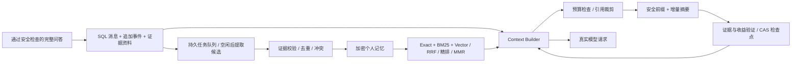
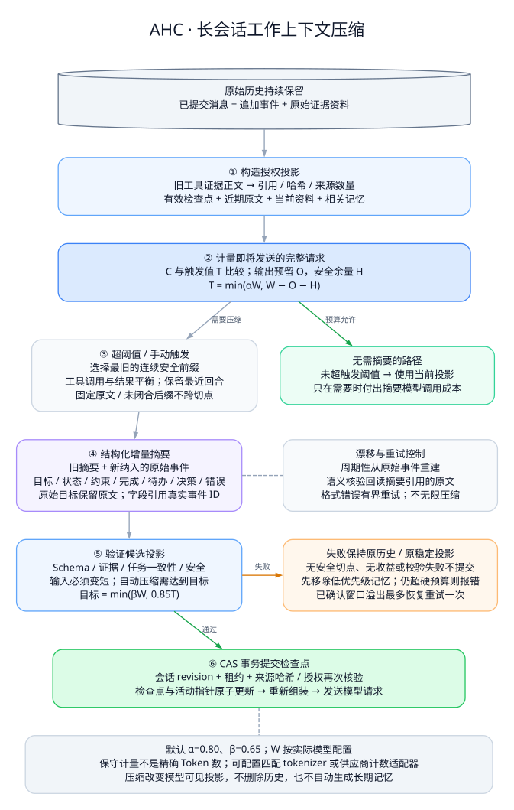
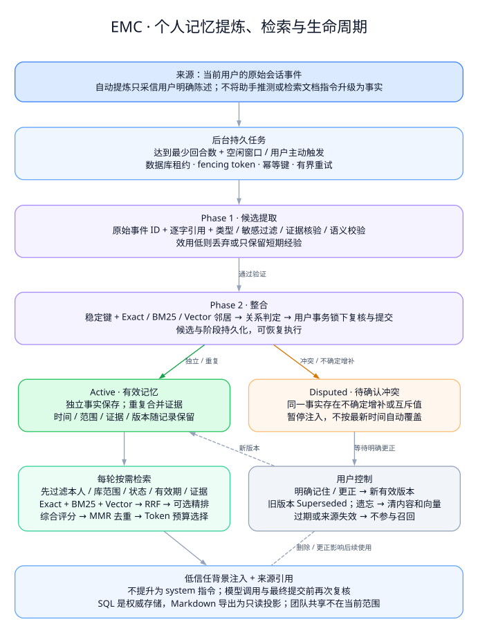

# 长上下文压缩与个人记忆

本实现依据工作区 `agent_memory_design/Agent_Memory_and_Context_Compaction.md` 的 AHC / EMC 设计，接入知恒（Continuum）现有账号、知识库范围、附件、安全审查和加密数据库。**压缩历史、跨会话记忆和原始日志是三套不同状态**，不再用“最后 10 条、每条 3000 字符”代替长对话管理。

## 用户操作

- 侧栏“记忆管理”：查看有效、争议和历史版本，主动记住一条信息、查看逐条来源、更正、遗忘，以及开关使用记忆和后台自动提炼。
- 聊天顶部“上下文与记忆”：查看预算和检查点，手动压缩、触发后台提炼、固定重要用户消息原文，或恢复原始投影 / 过去的有效检查点。
- 更正同一主体、属性和知识库范围的事实会创建新版本，旧版变为 `superseded`。模糊矛盾由后台标为 `disputed`，不采用简单的“最新覆盖旧的”。
- 关闭记忆后不再注入或自动提炼，已存记录保留；遗忘清空记录内容和向量，取消相关待处理任务，以墓碑阻止后台自动复活。原始聊天记录仍按会话删除规则保留。
- 知识库相关记忆仍受当前选库范围及实时授权限制。个人记忆可用于普通对话；记忆是背景资料，不能覆盖当前用户要求和系统规则。

## 数据和流程



### 原始事件与工作上下文



[高清 PNG](assets/diagrams/context-compaction.png) · [可编辑源图与渲染方式](assets/diagrams/README.md)

`messages` 保留用户/助手消息；`memory_events` 为通过最终检查的消息和已使用证据建立稳定序号。`tool_call`/`tool_result` 表示本系统实际读取的 RAG 证据，不伪称具备任意 shell 工具执行能力。完整来源存入 `memory_artifacts`，模型投影采用引用、哈希和来源数量，避免每轮重复传入旧来源全文。引用可以经本人鉴权接口回读。

本系统继续遵守既有安全约束：**被拦截的问答不写入消息或记忆事件**。因此事件在成功提交完整问答时同事务写入，而非按通用 Agent 伪代码预先保存不安全用户输入；崩溃时不会留半条已交付消息。现有会话首次打开上下文时把已批准消息转换为事件，不从摘要反推原始事实。

压缩只覆盖最旧的连续安全前缀，保留最近完整回合和未闭合后缀。固定原文阻止切点越过该消息，工具调用与结果必须平衡。结构化摘要含原始目标、当前状态、约束、已完成、待办、决策、错误及下一步，每项必须引用真实事件。原始目标由程序保留，摘要经格式、证据和安全检查；周期性从原始事件重建以限制递归漂移。只有具有收益且自动压缩达到目标预算，才以会话版本和租约进行 CAS 提交。失败、取消、过期租约或来源变化不替换原始历史。

每次实际模型调用前重建请求并计量，包含 system、用户 JSON、历史、工具定义及响应格式。当前问题、近期原文和固定原文不会被静默截断。收到供应商确认的上下文溢出错误码后最多恢复重试一次，429、认证失败和普通 400 不按溢出处理。预算仍不足返回 `context_budget_exceeded`，可减少附件、取消固定、手动压缩或开启新会话。

### 长期记忆与检索



[高清 PNG](assets/diagrams/memory-lifecycle.png) · [DOT 源文件](assets/diagrams/memory-lifecycle.dot)

完成至少 3 轮后安排持久化任务，默认等会话空闲 300 秒；不会每条消息立即调用提取模型。用户也可点击“提炼长期记忆”。任务先从原始事件产生候选，逐字引用与来源身份核验、敏感信息过滤、模型语义验证通过后进入第二阶段整合。当前 RAG 文档是第三方证据，**不把模型自己的回答或文档中的命令自动当成用户已确认事实**；自动提炼默认只接收用户明确陈述。

候选沿用设计中的效用权重，低于 0.45 丢弃，0.45–0.75 只保留有到期时间的情节记忆，0.75 以上可保存语义记忆。评分是可调启发式，不等于准确率。稳定键使用 HMAC；同义记忆由 Exact/BM25/向量邻居和模型关系判断整合，重复合并证据，不确定的增补/矛盾交由用户确认。显式记住、更正不受普通效用门槛限制，但仍执行权限与安全检查。

检索先过滤用户、知识库范围、状态、有效期和证据权限，再做三路召回、RRF、可选模型精排、综合质量/效用/时间评分与 MMR 去重，最后按 Token 预算选择。所选记忆以低信任 `memory_context` 和有来源的检索片段加入用户数据，永不直接提升成 system 指令。生成前与提交前再次核验所有实际使用过的记忆与事件；并发删除/更正/撤权不会静默放行旧答案。

## 配置与计量

共享 profile 已包含压缩及记忆算法字段。未使用 profile 时在 `.env` 以 `RAGE_` 前缀设置；使用 profile 时修改 JSON 的小写字段，禁止冲突覆盖。默认值：

| 配置 | 默认值 |
|---|---:|
| `context_compaction_enabled` / `memory_enabled` | true / true |
| `context_window` | 128000（部署者应按实际模型窗口填写） |
| `context_trigger_ratio` / `context_target_ratio` | 0.80 / 0.65 |
| `context_headroom` | 至少 2048，实际取 max(配置值, 3%窗口) |
| `context_keep_recent` / `context_summary_tokens` | 20000 / 4000 |
| `context_max_attempts` / `context_rebuild_interval` | 2 / 8 |
| `memory_token_budget` | min(6000, 8%窗口) |
| `memory_candidates` / `memory_mmr_eta` | 32 / 0.75 |
| `memory_min_turns` / `memory_max_records` | 3 / 1000 |
| `memory_episode_days` | 90 |

触发值 `min(0.8W, W-O-H)`，目标 `min(0.65W, 0.85T)`；每次请求按其实际输出预留 `O` 计算。`context_model_windows` 可以覆盖具体模型窗口。输出预算、计量和压缩增加的成本均可在指标中观察。

三种计量方式：

1. **`conservative`（默认）**：对完整文本请求使用 UTF-8 字节上界式预算及额外余量。**不是精确 Token 计数**，可能提前触发压缩；界面明确标注。图片直接由独立视觉链路按页数/像素和超时控制，图片 Base64 不塞入主模型的文本计量。
2. **`huggingface`**：本地模型对应 tokenizer + `apply_chat_template`，只加载本地文件、禁用远程自定义代码。安装已有 `local-models` extra，将正确 tokenizer 目录配置为 `RAGE_CONTEXT_TOKENIZER_PATH`；不同模型模板不能混用。响应格式引入的供应商隐含开销仍留安全余量。
3. **`provider`**：独立计数适配接口，接收 `{model,messages,tools?,response_format?}`，返回 `{"input_tokens":整数}`；配置 `RAGE_CONTEXT_COUNT_URL` 和独立的 `RAGE_CONTEXT_COUNT_API_KEY`。**这不是声称 DeepSeek 提供了某个通用 `/count_tokens` 路径**；应由部署方对接实际供应商能力。计数失败报错，不静默回退估计。

计量相关的文件路径、计数端点及 Key 不进入共享策略 JSON。设计依据：[模型聊天模板计数](https://huggingface.co/docs/transformers/main/en/chat_templating)。上线前应对照供应商 `usage.prompt_tokens` 校准当前模型与模板。

## 持久化与后台任务

新增 `0009` 迁移。消息事件、资料正文、摘要、候选、记忆内容和向量使用现有 AES-256-GCM；归属、版本、状态等查询元数据留在 SQL。密钥轮换覆盖全部新增加密字段。SQLite 支持开发，PostgreSQL 支持生产事务；不引入独立不一致的文件数据库。

记忆规模默认受每用户 1000 条限制，因此当前 Exact/BM25/稠密向量搜索在**经 ACL 过滤的 SQL 记忆集合**上执行，CPU 部分在线程处理；知识库依旧使用原 Milvus。记忆向量与权威状态同事务更新，删除不留下可检索的外部旧索引。Embedding 空间变化时旧向量不参与语义通道，可调用 `POST /api/v1/memory/reindex` 重建；关键词和精确召回仍可用。不要把这一有界方案描述成百万级向量数据库吞吐。

`MEMORY.md` 通过鉴权导出为人类可读的分类索引，不在服务器落明文副本；导出是数据库只读投影，编辑应走管理接口。到期、删除、争议或来源失效的记录不导出到活动索引。原始历史按会话生命周期保留；删除会话级联清理事件/资料/检查点/任务，依赖其证据的记忆自动失效。导出的文件和历史备份由使用者自行保管。

内嵌 worker 默认每 10 秒扫描数据库任务，提炼与整合分两阶段存储，任务有租约、fencing token、指数退避、幂等键和默认 3 次上限。多 worker 可以同时运行，最终整合按用户事务锁序列化。进程重启可回收过期租约；用户更正/遗忘使旧任务失效。测试环境不自动启动 worker。

独立 worker 可在同一部署配置下运行：

```bash
# API 进程可设置 RAGE_MEMORY_WORKER_ENABLED=false，改用下面的独立进程。
uv run --inexact python -m app.cli memory-worker
# 运维单次处理一个可执行任务
uv run --inexact python -m app.cli memory-worker --once
```

这是数据库持久队列实现，不要求额外部署 Celery；Redis 继续用于原缓存。可配置 `RAGE_MEMORY_IDLE_SECONDS`、`RAGE_MEMORY_WORKER_INTERVAL`、`RAGE_MEMORY_JOB_TIMEOUT`、`RAGE_MEMORY_JOB_ATTEMPTS`。自动提炼会调用现有 LLM、Embedding 和可用的精排服务，产生对应费用。

## 升级、接口与监控

生产备份并停止写入后执行，实际业务库不会由开发测试自动迁移：

```bash
uv run --inexact alembic upgrade head
uv run --inexact alembic current
```

所有用户接口要求 `chat.use`、登录请求签名和本人归属：

| 接口 | 功能 |
|---|---|
| `GET/POST /api/v1/memory` | 列表、显式记住 |
| `PATCH/DELETE /api/v1/memory/{id}` | 带 expected_version 更正 / 遗忘同一事实全部版本 |
| `DELETE /api/v1/memory` | 遗忘全部并设置重新提炼时间边界 |
| `PATCH /api/v1/memory/preferences` | 使用记忆 / 自动提炼开关 |
| `GET /api/v1/memory/{id}/evidence` | 原始证据回读 |
| `GET /api/v1/memory/artifacts/{id}` | 完整历史资料回读 |
| `GET /api/v1/memory/export/markdown` | 导出活动记忆索引 |
| `POST /api/v1/memory/reindex` | 重建本人有效记忆向量 |
| `GET /api/v1/conversations/{id}/context` | 当前检查点、预算、事件和固定列表 |
| `PUT .../context/pins` | 固定用户原文，不跨过此切点压缩 |
| `POST .../context/compact` | 手动压缩 |
| `POST .../context/restore` | 恢复有效检查点；checkpoint_id=null 恢复原始投影 |
| `POST .../memory/extract` | 立即排入两阶段提炼任务 |

Profiler / Langfuse 记录 `context.compact`、`memory.retrieve`、`memory.pipeline`；新增 Prometheus `rag_e_context_compactions_total`、`rag_e_context_reduction_ratio`、`rag_e_context_input_units`。搜索和压缩输出不进入正文追踪，任务错误只存类型/业务码，审计不保存正文或凭据。

## 验收与边界

运行 `pytest -q tests/test_memory_context.py` 验证原始历史保留、工具配对、安全切点、检查点恢复、并发版本、跨用户与知识库权限、记忆更正和遗忘、任务幂等及计数协议。前端验证记忆与上下文面板操作。demo 压缩为确定性的摘录基线，demo 自动提炼返回空候选；不能把它当作真实模型记忆质量。

本次工程测试使用隔离数据库和模拟模型协议；没有用文档中的 55.6% 示例代替测量，也未宣称真实任务成功率提升。后续应按原设计的 Memory Continuity Benchmark 用固定多轮任务对照压缩前后的事实保持、任务继续能力、召回、成本及延迟。当前系统是 RAG 问答，不包含任意有副作用工具的自动重放或分支执行引擎；原始证据可回读，压缩检查点可恢复，团队共享记忆按本次确认暂不实现。
